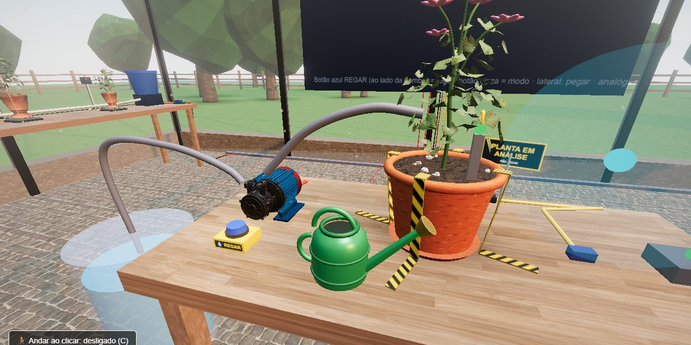
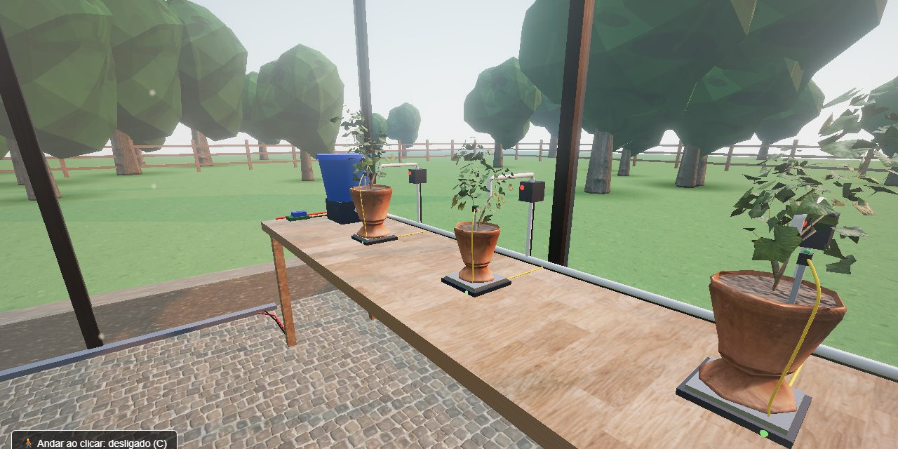
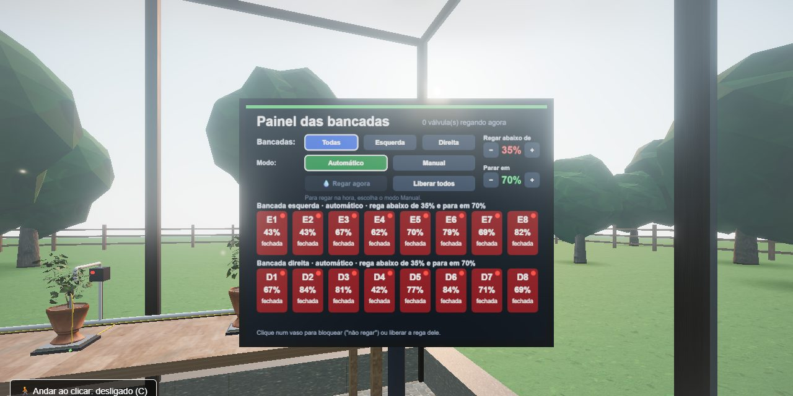
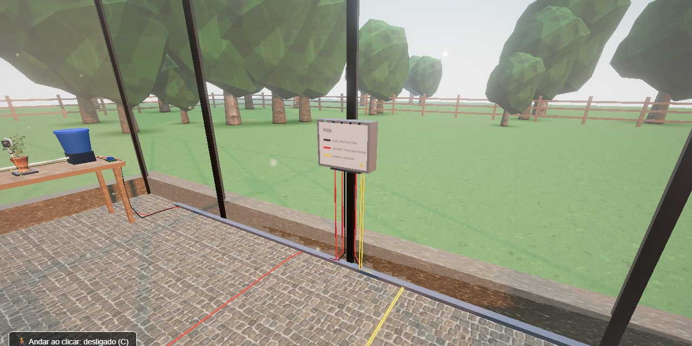

# Sala VR - Estufa IoT

Sala de realidade virtual feita com **three.js** e **WebXR**, onde um sistema de irrigação IoT pode ser observado e controlado com o controle do headset.

**Acesse:** https://cassio024.github.io/sala-vr-estufa-iot/ (no PC ou no navegador do headset)


| Mesa principal | Bancadas com balanças e sensores |
|---|---|
|  |  |
| **Painel das bancadas** | **Placa-mãe e fios** |
|  |  |

Tour animado (versão anterior da sala): [docs/img/tour.gif](docs/img/tour.gif)

## O que tem na sala

| Item | Função |
|---|---|
| Sensor de umidade (haste no vaso) | Lê a umidade do solo (0–100%). Com o tempo, a terra seca sozinha. LED: verde = ok, vermelho = seco, **azul piscando = água em excesso**, cinza = fora do solo. |
| Água em excesso | Acima de **90%** o sensor acusa solo **encharcado**: a bomba para, o botão REGAR fica bloqueado (cinza), toca um alerta, o painel mostra **⚠ ÁGUA EM EXCESSO**, a água empoça na terra e no pratinho e as folhas amarelam um pouco. Libera quando a terra seca abaixo de 85%. |
| Bomba d'água + tubo | Liga sozinha quando a umidade cai abaixo de 35% e desliga ao chegar em 70% (modo automático). |
| Botão REGAR (azul, na frente da bomba) | Rega manual por alguns segundos, no modo automático ou manual. Afunda ao apertar e acende enquanto a bomba rega. |
| Sensor de proximidade (plaquinha azul na mesa) | Detecta quando a mão/controle chega perto: o LED dele acende e o painel mostra "mão detectada". Não rega; a rega manual é só pelo botão REGAR. |
| Botão de modo (caixa cinza) | Alterna entre **automático** e **manual**. |
| Painel na parede | Mostra umidade, estado da bomba, modo, proximidade e últimos eventos. |
| Painel das bancadas (perto da porta, à direita) | Escolha **Todas / Esquerda / Direita**, o modo **Automático / Manual**, **💧 Regar agora** (no manual), **Liberar todos** e os limites do automático: **Regar abaixo de** (padrão 35%) e **Parar em** (padrão 70%), com − / + de 5 em 5% (sempre com 10% de diferença entre eles e no máximo 85%). A grade mostra os 16 vasos (umidade e estado); **clique num vaso para bloquear ("não regar") ou liberar** a rega dele. Funciona com mouse, mira do modo FPS e raio do controle VR. |
| Placa-mãe (fundo da estufa, na parede) | Caixa do ESP32 que recebe todos os fios: **preto** = sinal dos relés, **vermelho** = força das bombas (motores das bancadas e bomba da mesa), **amarelo** = sensores (umidade e proximidade). Os LEDs mostram energia, o programa rodando (pisca) e cada bomba ligada. O fio do sensor de umidade acompanha o sensor quando ele é pego. |
| Vasos das bancadas | Podem ser **pegos e movidos** (PC: modo FPS · VR: gatilho lateral). Soltos, caem e pousam na balança, na bancada, na mesa ou no chão. Cada vaso tem um **sensor de umidade** espetado na terra, com o fio amarelo descendo por fora do vaso até a balança. A terra seca devagar (0,3 a 0,6 % por segundo). |
| Balança de segurança (embaixo de cada vaso) | A válvula só abre com um vaso **em cima da balança** (nem o "Regar agora" abre sem vaso). LED da balança: **verde** = vaso detectado, **vermelho** = vazia. Tirou o vaso, o painel mostra "vazio" e a água não cai na bancada. |
| Vaso principal (mesa) | **Planta em análise**: preso à mesa com fitas zebradas e uma etiqueta — não pode ser pego. |
| Irrigação das bancadas | Em cada bancada: motor com **caixa d'água** em cima, placa **ESP32 + relés** e um cano até cada vaso. Em cada curva, uma **válvula solenoide** com luz **vermelha** (fechada) e **verde** (regando) e um **bipe** ao abrir. Cada vaso tem seu sensor: abre abaixo de 35% e fecha em 70%. Os cabos correm junto do cano (preto = relés → válvulas, amarelo = sensores → balanças). As peças não têm etiqueta: a placa perto da bancada esquerda explica válvula → relé → placa, a balança e o sensor. |
| Cerca de madeira (limite do mapa) | Cerca em volta do mapa inteiro (x = ±22 m, z = ±20 m). Andando (FPS, analógico da VR ou clique no chão) o jogador para antes dela e não sai do mapa. |

## Como jogar

**No headset (VR):**
- Clique em **Enter VR**.
- Aponte o controle para o **botão de modo** e aperte o gatilho para trocar entre automático e manual.
- Encoste o controle no **botão azul REGAR** (na frente da bomba) e aperte o gatilho para regar.

**No computador (sem headset):**
- Arraste o mouse para girar a câmera e use a roda para aproximar.
- Clique no **botão cinza** para trocar o modo.
- Clique no **botão azul REGAR** (na frente da bomba) para regar.
- Atalhos: `M` troca o modo, `Espaço` rega.
- **Andar ao clicar no chão:** opção que começa **desligada**. Ligue pelo botão 🚶 no canto inferior esquerdo ou pela tecla `C` (a escolha fica salva no navegador).

**Modo FPS (como um jogo, no computador):** aperte **F** ou clique em **🎮 Modo FPS** (canto inferior esquerdo).
O mouse fica preso na tela, como num jogo de tiro em primeira pessoa.

| Comando | Ação |
|---|---|
| `W` `A` `S` `D` / setas | Andar |
| `Shift` | Correr |
| Mouse | Olhar em volta |
| Clique esquerdo | Usar o que está na mira (botão cinza, botão REGAR, placas, porta, painel) · pegar o regador ou o sensor · soltar onde estiver mirando |
| Botão direito (segurando o regador, mirando o vaso) | Regar |
| `M` / `Espaço` | Modo auto/manual · rega manual |
| `Esc` | Sair do modo FPS |

Não dá para atravessar paredes, mesa, bancadas e reservatório; para entrar e sair da estufa, use a porta.
Para espetar o sensor de volta no vaso, segure-o, mire no vaso e clique.

## Como rodar

WebXR só funciona em **HTTPS** ou em `localhost`. Por isso:

1. Clone o repositório e abra a pasta.
2. Suba um servidor local, por exemplo:
   ```bash
   python -m http.server 8080
   ```
   ou `npx serve .`
3. Abra `http://localhost:8080` no navegador.

Para usar no **Meta Quest** (ou outro headset), o jeito mais simples é publicar no **GitHub Pages** (veja abaixo) e abrir o link no navegador do headset.

## Abrir no headset (Meta Quest)

**Acesso rápido:** aponte a câmera do headset para o QR code abaixo, ou abra o link `https://cassio024.github.io/sala-vr-estufa-iot/` no navegador dele.


1. No Quest, abra o app **Navegador** (Meta Quest Browser).
2. Digite `cassio024.github.io/sala-vr-estufa-iot` e espere a sala carregar.
3. Toque em **ENTER VR** (botão embaixo da página) e permita o acesso à realidade virtual.
4. Controles: **gatilho** perto do botão cinza troca o modo; perto do botão azul REGAR rega · **gatilho lateral** pega o regador e o sensor · **analógico esquerdo** anda (para onde você está olhando, sem atravessar paredes e móveis) · **analógico direito para os lados** gira 30° · **analógico direito para frente** mira e teletransporta.

Se o botão mostrar **VR NOT SUPPORTED**, o navegador não tem WebXR (use o navegador do Quest, não um app de vídeo). Se mostrar **WEBXR NEEDS HTTPS**, o link foi aberto com `http://` — use o endereço do GitHub Pages, que é HTTPS.

### Diagnóstico no headset

Abra `https://cassio024.github.io/sala-vr-estufa-iot/?debug` e uma linha amarela aparece no painel da sala com:
FPS, draw calls, triângulos, qualidade (leve/completa) e se há HTTPS, WebXR e suporte a VR.
Meta no Quest: **72 a 90 FPS** estáveis.

### Checklist de teste em VR

| Item | Como conferir | Resultado |
|---|---|---|
| Link abre no navegador do Quest | Página carrega e mostra a estufa | ☐ |
| Botão **ENTER VR** aparece e entra na VR | Toque no botão | ☐ |
| Altura do chão correta | Mesa na altura da cintura | ☐ |
| FPS ≥ 72 | `?debug`, olhar o painel | ☐ |
| Gatilho no botão cinza troca o modo | Painel mostra "manual"/"automático" | ☐ |
| Gatilho no botão REGAR rega | Bomba liga, gotas caem | ☐ |
| Pegar regador e sensor (gatilho lateral) | Objeto segue a mão | ☐ |
| Andar com o analógico esquerdo (sem atravessar paredes) | Analógico esquerdo | ☐ |
| Teletransporte e giro | Analógico direito | ☐ |
| Vibração e som | Ao regar / bomba ligada | ☐ |

## Desempenho (headset standalone)

O Quest roda o navegador numa GPU de celular. Por isso a sala detecta o headset e usa um **modo leve** automaticamente:

| | PC (completa) | Headset (leve) |
|---|---|---|
| Planta glTF (Poly Haven comprimida, ~8 mil tri) | sim | sim |
| Bomba d'água | modelo `bomba.glb` (150 mil tri) | **bomba feita por nós** (`js/scene/pump.js`, ~1.350 tri: motor com aletas, cabeçote, base; vibra ligada) |
| Árvores (InstancedMesh, 2 draw calls) | 70 | 40 |
| Jardim: flores, arbustos, grama (InstancedMesh, 1 draw call por tipo) | todas as cópias | metade das cópias |
| Cerca de madeira em volta do mapa (InstancedMesh, 2 draw calls) | sim | sim |
| Plantas reais nas bancadas (16 vasos pegáveis) | sim | sim |
| Nuvens, poeira e pós-processamento | sim | não |
| Draw calls (vista de dentro da estufa, medido com `?debug`) | ~120 | ~100 |
| Sombra (1 luz só) | 2048 px | 1024 px |
| `setPixelRatio` | até 1,5 | 1 |
| Renderização foveada | `setFoveation(1)` | `setFoveation(1)` |

A planta da mesa usava o `planta.glb` (6,3 MB, ~176 mil triângulos, com um vaso próprio que flutuava sobre o vaso da mesa).
Ela foi trocada pela mesma "Potted Plant 01" da Poly Haven na versão comprimida (`polyhaven/potted_plant_01.glb`: 605 KB, ~8 mil triângulos, só caule e folhas), que agora aparece também no headset.
O modelo da bomba (150 mil triângulos) é pesado demais para o Quest, então no headset aparece uma bomba feita por nós com formas simples (`js/scene/pump.js`): cabeçote de inox com entrada e saída, motor azul com aletas, tampa do ventilador, base e caixa de ligação. Ligada, ela vibra e o eixo gira.

O jardim tinha ~180 objetos clonados, cada um com a própria draw call. Agora cada tipo de planta e a cerca são desenhados com um `InstancedMesh`, então o modo leve mostra o mesmo cenário (árvores, cerca, jardim e plantas nas bancadas), só com menos cópias.

Forçar a qualidade pela URL: `?qualidade=baixa` ou `?qualidade=alta`.
Começar com a terra numa umidade (para demonstrar seco ou encharcado): `?umidade=20` ou `?umidade=95`.


## Testes

A lógica dos sensores e da bomba (`js/sensors.js`) é testada sem precisar do three.js nem de instalar pacotes (Node 18+):

```bash
npm test
```

Cobre: histerese da bomba (liga < 35%, desliga em 70%), limites 0–100%, sensor fora do solo, modo manual, log de eventos e sensor de proximidade, além de uma simulação de 10 minutos.

## Publicar no GitHub Pages

1. No GitHub, vá em **Settings → Pages**.
2. Em **Source**, escolha **Deploy from a branch**, branch `main`, pasta `/ (root)`.
3. Depois de alguns minutos o site fica em `https://SEU-USUARIO.github.io/NOME-DO-REPO/`.

## Estrutura

```
index.html            -> página, import map do three.js e botão VR
vendor/three/          -> three.js 0.170.0 local (só os arquivos usados)
js/main.js            -> ponto de entrada: junta os módulos e roda o loop principal
js/sensors.js         -> lógica dos sensores, da bomba e do modo automático (sem three.js)
js/scene/room.js      -> estufa, bancadas, luminária e mesa
js/scene/plant.js     -> vaso, solo e planta (murcha quando o solo seca, empoça quando encharca)
js/scene/fence.js     -> cerca de madeira no limite do mapa
js/scene/pump.js      -> bomba d'água feita por nós (modo leve / headset)
js/scene/devices.js   -> sensor, regador, bomba, reservatório, botão de modo, proximidade
js/scene/surfaces.js  -> onde objetos soltos e gotas pousam (chão, mesa, solo)
js/scene/water.js     -> gotas de água
js/ui/panel.js        -> painel de status
js/input.js           -> mouse e teclado (PC)
js/fps.js             -> modo FPS: W A S D, mouse preso, mira, pegar/soltar e regar
js/collision.js       -> colisão com paredes, porta e móveis (FPS e joystick da VR)
js/valves.js          -> lógica das válvulas solenoides das bancadas (um sensor e um relé por vaso)
js/scene/bench-irrigation.js -> motores, caixas d'água, canos, válvulas com LEDs, gotas, bipe e placa explicativa
js/ui/control-panel.js -> painel das bancadas: seleção, modo, regar agora, bloquear vaso
js/scene/analysis.js  -> fitas e etiqueta do vaso principal (planta em análise)
js/scene/mainboard.js -> placa-mãe no fundo da estufa e os fios até relés, bombas e sensores
js/ui/options.js      -> opção "andar ao clicar" (PC)
js/interaction.js     -> controles VR: pegar objetos, teletransporte, giro, vibração
js/environment.js     -> renderer, HDRI, materiais PBR, construção da estufa
js/audio.js           -> sons espaciais gerados por código
js/models.js          -> carregamento de modelos glTF (com fallback)
js/quality.js         -> modo leve para headset, medidor de FPS e diagnóstico (?debug)
tests/                -> testes da lógica (npm test)
assets/               -> HDRI, texturas e modelos
firmware/           -> firmware do ESP32 (Wokwi)
```

A lógica de irrigação fica separada em `sensors.js` para facilitar a troca por dados reais.

## Próximos passos (integração com o ESP32)

Hoje os sensores são **simulados** em `js/sensors.js`. Para ligar ao hardware real:

1. Trocar `SoilMoistureSensor.read()` por uma leitura vinda do ESP32 (MQTT via WebSocket ou uma API HTTP).
2. Enviar comandos de bomba de volta ao ESP32 em `IrrigationController`, no lugar de só mudar `pumpOn`.
3. Manter a mesma interface (`read`, `addWater`, `update`), e a sala continua funcionando.

## Firmware (Wokwi)

O firmware do ESP32 que alimenta a estufa está em `firmware/` e é simulado no
[Wokwi](https://wokwi.com/projects/481428343946592257) (projeto "projeto_pra_vr").

- Placa: ESP32 DevKit C v4
- Sensores: solo, LDR, DHT22, HC-SR04
- Atuador: relé (bomba d'água) com histerese
- Comunicação: MQTT no broker HiveMQ, tópicos `estufa/vr/*`

A sala VR consome a telemetria publicada pelo firmware e envia comandos de
bomba/configuração de volta. Para rodar a simulação localmente, abra a pasta
`firmware/` no VS Code com a extensão Wokwi.

## Créditos e licenças

| Arquivo | Origem | Autor | Licença |
|---|---|---|---|
| `assets/models/bomba.glb` | [Water Pump — Sketchfab](https://sketchfab.com/3d-models/water-pump-76ca12fd7aec4748b96445892b1a5d95) | [OOtis_Pro](https://sketchfab.com/Mohit.Lodhi) | [CC-BY 4.0](http://creativecommons.org/licenses/by/4.0/) (exige crédito) |
| `assets/models/polyhaven/*.glb` (flores, arbustos, samambaias, grama, vasos, árvores) | [Poly Haven](https://polyhaven.com) — island_tree_02/03, pine_tree_01, fir_sapling_medium, shrub_01, shrub_03, shrub_04, flower_gazania/heliophila, periwinkle_plant, dandelion_01, celandine_01, fern_02, moss_01, calathea_orbifolia_01, grass_medium_01/02, potted_plant_01, planter_pot_clay | Poly Haven | CC0 (uso livre) |
| `assets/models/polyhaven/island_tree_02.glb`, `planter_box_01.glb`, `potted_plant_04.glb`, `garden_hose_wall_mounted_01.glb` | [Poly Haven](https://polyhaven.com) (árvore real e objetos da estufa) | Poly Haven | CC0 |
| `assets/textures/casca/*` | [bark_brown_02](https://polyhaven.com/a/bark_brown_02) | Poly Haven | CC0 |
| `assets/textures/pedras/*` | [cobblestone_floor_02](https://polyhaven.com/a/cobblestone_floor_02) | Poly Haven | CC0 |
| `assets/textures/grama/normal.jpg` | [grass_ground](https://polyhaven.com/a/grass_ground) (só o relevo; a cor é gerada por código) | Poly Haven | CC0 |
| `assets/hdri/estufa.hdr` | *a confirmar com quem adicionou* | — | — |
| `assets/textures/madeira/*`, `assets/textures/piso/*` | *a confirmar com quem adicionou* | — | — |

Os dados da bomba vêm dos metadados do próprio arquivo glTF. Sons e texturas de reserva (quando os arquivos não carregam) são gerados por código neste projeto.

## Tecnologias

- [three.js](https://threejs.org/) 0.170.0 — cópia local em `vendor/three` (MIT): a sala funciona **sem internet** e sem depender de CDN
- WebXR Device API (`VRButton` do three.js)
