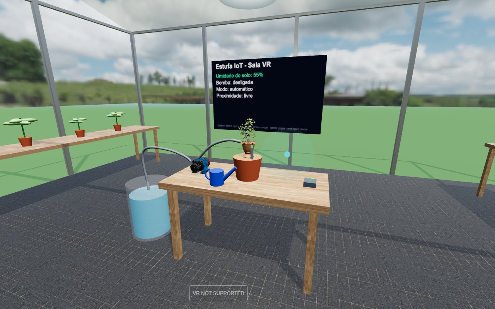
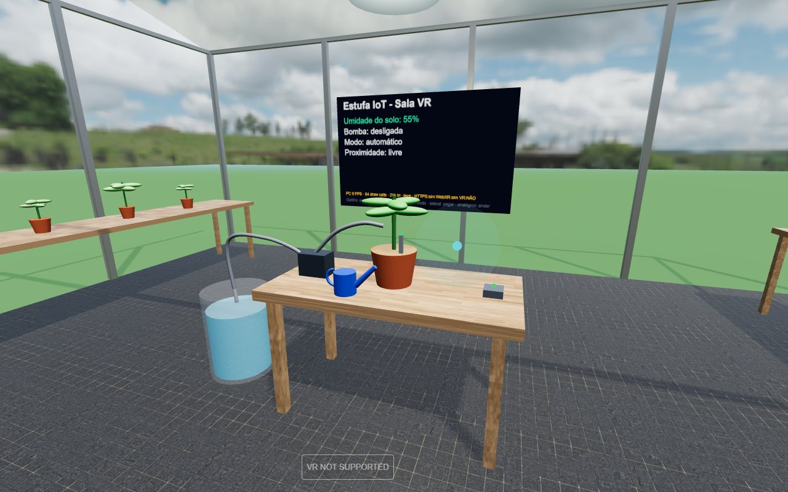

# Sala VR - Estufa IoT

Sala de realidade virtual feita com **three.js** e **WebXR**, onde um sistema de irrigação IoT pode ser observado e controlado com o controle do headset.

**Acesse:** https://cassio024.github.io/sala-vr-estufa-iot/ (no PC ou no navegador do headset)



## O que tem na sala

| Item | Função |
|---|---|
| Sensor de umidade (haste no vaso) | Lê a umidade do solo (0–100%). Com o tempo, a terra seca sozinha. |
| Bomba d'água + tubo | Liga sozinha quando a umidade cai abaixo de 35% e desliga ao chegar em 70% (modo automático). |
| Sensor de proximidade (esfera azul) | Dispara quando a mão/controle entra na área azul. Com o gatilho, faz uma rega manual. |
| Botão de modo (caixa cinza) | Alterna entre **automático** e **manual**. |
| Painel na parede | Mostra umidade, estado da bomba, modo, proximidade e últimos eventos. |

## Como jogar

**No headset (VR):**
- Clique em **Enter VR**.
- Aponte o controle para o **botão de modo** e aperte o gatilho para trocar entre automático e manual.
- No modo manual, aponte para a **esfera azul** e aperte o gatilho para regar.

**No computador (sem headset):**
- Arraste o mouse para girar a câmera e use a roda para aproximar.
- Clique no **botão cinza** para trocar o modo.
- Clique na **esfera azul** para regar (rega manual).
- Atalhos: `M` troca o modo, `Espaço` rega.

## Como rodar

WebXR só funciona em **HTTPS** ou em `localhost`. Por isso:

1. Clone o repositório e abra a pasta.
2. Suba um servidor local, por exemplo:
   ```bash
   python -m http.server 8080
   ```
   ou `npx serve .`
3. Abra `http://localhost:8080` no navegador.

Para usar no **Meta Quest** (ou outro headset), o jeito mais simples é publicar no **GitHub Pages** (veja abaixo) e abrir o link no navegador do headset.

## Abrir no headset (Meta Quest)

1. No Quest, abra o app **Navegador** (Meta Quest Browser).
2. Digite `cassio024.github.io/sala-vr-estufa-iot` e espere a sala carregar.
3. Toque em **ENTER VR** (botão embaixo da página) e permita o acesso à realidade virtual.
4. Controles: **gatilho** perto do botão cinza troca o modo; perto da esfera azul rega · **gatilho lateral** pega o regador e o sensor · **analógico para frente** mira e teletransporta · **analógico para os lados** gira 30°.

Se o botão mostrar **VR NOT SUPPORTED**, o navegador não tem WebXR (use o navegador do Quest, não um app de vídeo). Se mostrar **WEBXR NEEDS HTTPS**, o link foi aberto com `http://` — use o endereço do GitHub Pages, que é HTTPS.

### Diagnóstico no headset

Abra `https://cassio024.github.io/sala-vr-estufa-iot/?debug` e uma linha amarela aparece no painel da sala com:
FPS, draw calls, triângulos, qualidade (leve/completa) e se há HTTPS, WebXR e suporte a VR.
Meta no Quest: **72 a 90 FPS** estáveis.

### Checklist de teste em VR

| Item | Como conferir | Resultado |
|---|---|---|
| Link abre no navegador do Quest | Página carrega e mostra a estufa | ☐ |
| Botão **ENTER VR** aparece e entra na VR | Toque no botão | ☐ |
| Altura do chão correta | Mesa na altura da cintura | ☐ |
| FPS ≥ 72 | `?debug`, olhar o painel | ☐ |
| Gatilho no botão cinza troca o modo | Painel mostra "manual"/"automático" | ☐ |
| Gatilho na esfera azul rega (modo manual) | Bomba liga, gotas caem | ☐ |
| Pegar regador e sensor (gatilho lateral) | Objeto segue a mão | ☐ |
| Teletransporte e giro | Analógico direito | ☐ |
| Vibração e som | Ao regar / bomba ligada | ☐ |

## Desempenho (headset standalone)

O Quest roda o navegador numa GPU de celular. Por isso a sala detecta o headset e usa um **modo leve** automaticamente:

| | PC (completa) | Headset (leve) |
|---|---|---|
| Modelos glTF (bomba, planta) | sim | não — formas simples |
| Triângulos na cena | ~350 mil (21 mil + 326 mil dos modelos) | **~21 mil** (medido) |
| Draw calls | ~85 | 65 (medido) |
| Sombra (1 luz só) | 2048 px | 1024 px |
| `setPixelRatio` | até 1,5 | 1 |
| Renderização foveada | `setFoveation(1)` | `setFoveation(1)` |

Os dois modelos glTF somam **~326 mil triângulos** (bomba 150 mil, planta 176 mil), acima da meta de ~100 mil para o Quest.
Para usá-los também no headset, eles precisam ser simplificados (ex.: Blender → *Decimate* para ~10 mil cada, e texturas de no máximo 1024 px).

Forçar a qualidade pela URL: `?qualidade=baixa` ou `?qualidade=alta`.



## Testes

A lógica dos sensores e da bomba (`js/sensors.js`) é testada sem precisar do three.js nem de instalar pacotes (Node 18+):

```bash
npm test
```

Cobre: histerese da bomba (liga < 35%, desliga em 70%), limites 0–100%, sensor fora do solo, modo manual, log de eventos e sensor de proximidade, além de uma simulação de 10 minutos.

## Publicar no GitHub Pages

1. No GitHub, vá em **Settings → Pages**.
2. Em **Source**, escolha **Deploy from a branch**, branch `main`, pasta `/ (root)`.
3. Depois de alguns minutos o site fica em `https://SEU-USUARIO.github.io/NOME-DO-REPO/`.

## Estrutura

```
index.html          -> página, import map do three.js e botão VR
js/main.js          -> cena, dispositivos, painel e loop principal
js/sensors.js       -> lógica dos sensores, da bomba e do modo automático
js/environment.js   -> renderer, HDRI, materiais PBR, estufa, bancadas, luminária
js/interaction.js   -> controles VR: pegar objetos, teletransporte, giro, vibração
js/audio.js         -> sons espaciais gerados por código
js/models.js        -> carregamento de modelos glTF (com fallback)
js/quality.js       -> modo leve para headset, medidor de FPS e diagnóstico (?debug)
tests/              -> testes da lógica (npm test)
assets/             -> HDRI, texturas e modelos
firmware/           -> firmware do ESP32 (Wokwi)
```

A lógica de irrigação fica separada em `sensors.js` para facilitar a troca por dados reais.

## Próximos passos (integração com o ESP32)

Hoje os sensores são **simulados** em `js/sensors.js`. Para ligar ao hardware real:

1. Trocar `SoilMoistureSensor.read()` por uma leitura vinda do ESP32 (MQTT via WebSocket ou uma API HTTP).
2. Enviar comandos de bomba de volta ao ESP32 em `IrrigationController`, no lugar de só mudar `pumpOn`.
3. Manter a mesma interface (`read`, `addWater`, `update`), e a sala continua funcionando.

## Firmware (Wokwi)

O firmware do ESP32 que alimenta a estufa está em `firmware/` e é simulado no
[Wokwi](https://wokwi.com/projects/481428343946592257) (projeto "projeto_pra_vr").

- Placa: ESP32 DevKit C v4
- Sensores: solo, LDR, DHT22, HC-SR04
- Atuador: relé (bomba d'água) com histerese
- Comunicação: MQTT no broker HiveMQ, tópicos `estufa/vr/*`

A sala VR consome a telemetria publicada pelo firmware e envia comandos de
bomba/configuração de volta. Para rodar a simulação localmente, abra a pasta
`firmware/` no VS Code com a extensão Wokwi.

## Tecnologias

- [three.js](https://threejs.org/) 0.170.0 (carregado pelo CDN jsDelivr)
- WebXR Device API (`VRButton` do three.js)
